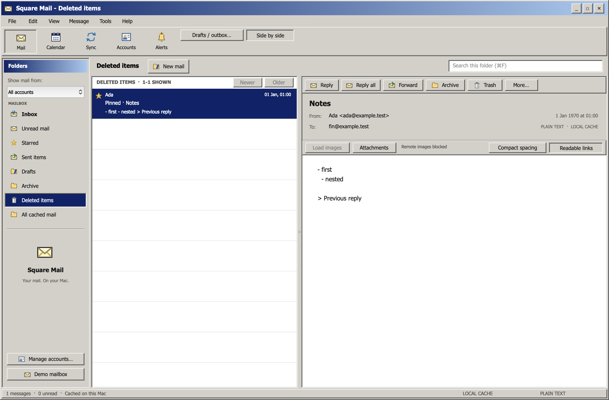
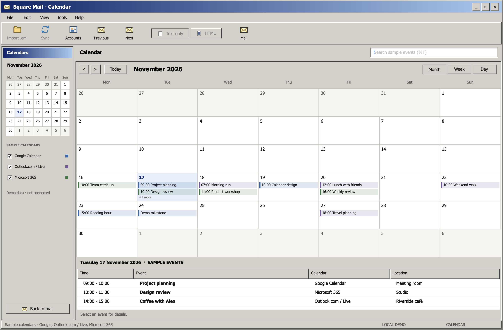

# Square Mail

A native macOS email reader with a reusable Visual Basic-era UI system.



The interface uses Swift and AppKit. The mail engine uses Rust. Lists, scrolling, selection, focus, text editing and window management stay native. WebKit is created only when an HTML body is requested. There is no browser application shell.

## Run

macOS 14+, Apple command-line developer tools, Rust and Swift are required. Development is currently qualified on Apple Silicon only.

```sh
./scripts/build.sh
open ".build/Square Mail.app"
```

The build creates a local ad-hoc-signed app. Xcode is not required to run the finished app. Distribution signing and notarization are not configured.

## Current reader

- Local demo mailbox, separate from personal mail.
- Import `.eml`, including MIME text/HTML alternatives and encoded headers.
- Persistent SQLite WAL cache with FTS5 prefix search.
- Native reusable rows with bounded pages and a draggable reading-pane divider.
- Side by side toolbar toggle and View menu choices for a reading pane below or on the right. The choice survives restart; the right-pane list shows sender, date, subject and preview.
- Older/Newer paging retains at most 250 message headers.
- Keyboard navigation, copy, text selection, search with ⌘F, sync with ⌘R, text/HTML with ⌘1/⌘2.
- Read-only Gmail and Microsoft Graph adapters, browser OAuth with PKCE and state validation, Keychain tokens and refresh.
- Multiple Gmail/Outlook accounts, a unified inbox, discovered folders and resumable header backfill. Bodies download on opening and remain available offline.
- Automatic bounded mail/calendar sync while open, with wake/reconnect catch-up and persisted retries.
- HTML sanitization, JavaScript disabled, nonpersistent WebKit storage, CSP and blocked subresources.
- Five-second idle release of the HTML renderer after returning to text.
- Lazy native calendar UI: month/week/day, mini calendar, per-account source filters, cached-event search and selected-day agenda. Demo mode remains separate from provider data.

See [account setup](docs/accounts.md), [architecture](docs/architecture.md), [contracts](docs/invariants.md), [performance](docs/performance.md) and [roadmap](docs/roadmap.md).

Open Calendar from its toolbar button or ⌘3. Return to Mail with ⌘4. Read-only calendar caches and sync are wired up. Editing and notifications are not implemented. See [calendar UI](docs/calendar.md) and [attachment plan](docs/attachments.md).



## Limits

This is a reader prototype. Gmail and personal Outlook live sign-in/cache reads were exercised; Microsoft 365 consent and broader live qualification remain pending. It does not send mail, edit provider state, browse attachments or deliver notifications. Header backfill is gradual, and provider reconciliation is still being qualified. Search covers downloaded headers, previews and text, not uncached provider bodies. Calendar views cap loaded events at 2,000, and account folder/source lists have explicit bounds. Dense-calendar pagination remains unfinished. HTML intentionally removes images and some formatting. There is no claim of performance parity with any other client.

Mail is stored as plaintext in `~/Library/Application Support/Square Mail/`, with user-only filesystem permissions. Tokens are stored separately in macOS Keychain. No telemetry is configured.

## UI system

`ClassicKit` is an independent Swift package product. It has no mail or Rust dependency. It provides the palette, Tahoma-first font selection, raised/inset borders, original pixel icons, buttons, title bars and native table cells. Coordinates use integral logical points; macOS draws at the display's backing scale, including 2× Retina. OS-owned sheets retain macOS styling.

Visual references: [visualbasic.world](https://visualbasic.world/), [Double Dragon Outlook Bar](https://github.com/Planet-Source-Code/vlad-vissoultchev-double-dragon-outlook-bar-control-photoshop-style-color-picker-now-witho__1-36529), and [Philip Naparan's inventory system](https://github.com/Planet-Source-Code/philip-v-naparan-a-complete-inventory-and-account-receivable-system-updated__1-62781). Their code, icons and fonts are not copied. Tahoma is used only when installed on the user's Mac.

## Check

```sh
./scripts/check.sh
```

The native integration probe starts a temporary demo mailbox and exercises the actual AppKit controller, Rust bridge, SQLite search and body reader. It never signs in or contacts a provider. Provider live qualification remains a separate release gate.

`scripts/profile.py` measures native selection through body layout and draw submission, startup, and process-family footprint. It can run a 1,000-switch stress test and include WebKit helpers. See [the performance method](docs/performance.md) before comparing numbers.

Original project code is MIT licensed. The project starts private under `finwarman/squaremail`, with public release planned after the release gates are met.

The original app icon uses editable geometry in `assets/icon.json`. SVG/PNG previews are in `assets/`; the app bundles `macos/Resources/AppIcon.icns`. Run `scripts/make-icon.sh` after editing the source.
