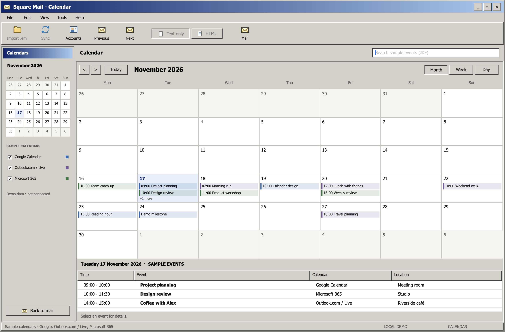

# Calendar UI

The native calendar is a read-only UI prototype with local sample events. The Google Calendar, Outlook.com/Live and Microsoft 365 entries are demo sources, not connected accounts.

- Month, week and day views, with Today and previous/next navigation.
- Mini calendar and selected-day agenda.
- Source visibility toggles and sample-event search.
- Event selection shows its sample details.
- `⌘3` opens Calendar; `⌘4` returns to Mail.

`ClassicCalendar` belongs to ClassicKit and has no mail/provider dependency. It paints one grid and reuses 42 native date hit targets. The agenda reuses row views. Calendar and sidebar views are constructed only when opened, then released on returning to Mail. Hidden mail HTML is eligible for the same five-second idle release as text mode.

The native probe checks month/week/day ranges, source/query filtering, month navigation and view release over repeated open/close cycles. The date-grid tests cover leap day and Monday week starts. Mail startup still begins without a calendar view.

Current limits: system time zone, sample events relative to the current date, no recurrence expansion, invitations, editing, drag/resizing or live updates. The fixed-height week/day grid shows 24 hours and the first all-day bar; the agenda carries all events on the selected day. Dense schedules, daylight-saving transitions, VoiceOver navigation and real provider calendars still need qualification.

Next stages are provider login, account/folder handling, real calendar caches and incremental sync, then notifications and editing. Preserve bounded background work and measure all owned helper processes. Attachment/linked-file previews are a separate stage.
