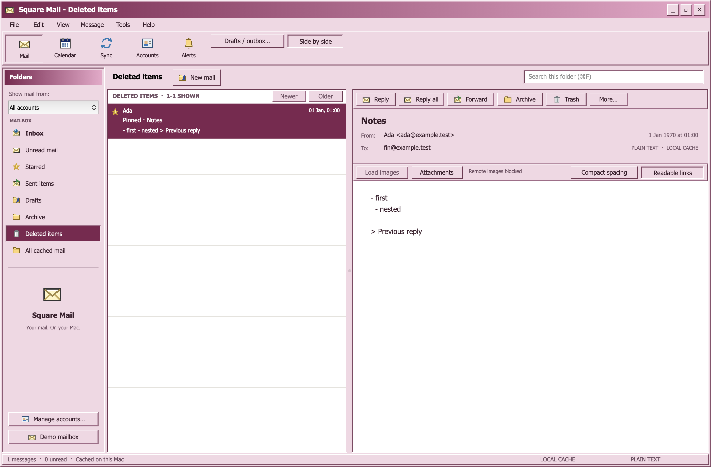
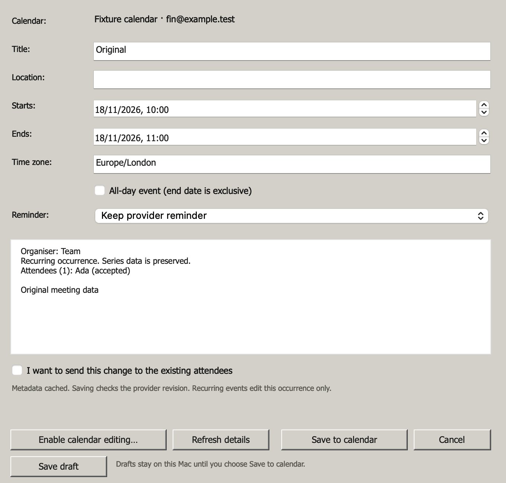

# ClassicKit design direction

The base is Visual Basic 6 and Windows 95/2000/XP-era desktop software: square geometry, compact native menus/tables, visible bevels, inset fields, grey control faces, navy selections, blue title gradients and original pixel icons. Logical points remain integral and draw at the display backing scale. Tahoma is used only when installed, with native fallbacks. Focus, scrolling, text editing and keyboard interaction remain AppKit-owned.

References: [Visual Basic archive](https://visualbasic.world/), [Double Dragon Outlook Bar](https://github.com/Planet-Source-Code/vlad-vissoultchev-double-dragon-outlook-bar-control-photoshop-style-color-picker-now-witho__1-36529), [inventory application](https://github.com/Planet-Source-Code/philip-v-naparan-a-complete-inventory-and-account-receivable-system-updated__1-62781). Reference code, icons and Windows fonts are not bundled.

The optional Pink palette follows Fin's18November Word screenshot: pale pink work surfaces, deeper pink title/toolbar hierarchy and pink selection/focus accents. It retains the base layout, bevel geometry and interaction. Gloss/heart decorations remain deferred. The checkerboard in the reference is image transparency, not a document background. The supplied reference is saved in the durable project design folder outside Git.

ClassicKit uses shared semantic colors for face, raised/inset edges, title start/end, ink/muted ink, selection, focus, today, selected day, calendar grid and time marker. View > Appearance saves Classic or Pink, applied before constructing views on the next launch. Existing editors and drafts remain intact. There is no theme observer or animation per row. Classic remains default. Selection, today, focus and message flags retain borders/icons. Contrast checks cover ink, muted text and selected text. Visible keyboard/VoiceOver and broader control contrast remain release gates.

ClassicKit stays independent of mail and Rust. Shared vector/layer drawing and small original assets avoid panel bitmaps and browser theme engines. A future WordCraft fork can map these tokens and asset geometry through its own renderer. No WordCraft code or cache is changed. Runtime theme switching without restart remains deferred.

Global controls navigate Mail/Calendar, sync and manage accounts/workspaces. Message controls sit above the email header. Primary actions wrap in narrow panes; secondary actions move to a native More menu. Rendering/attachment controls remain local to the reader. Progress uses the same bevel and selection colors: segmented motion for unknown work, filled segments for known image totals. Animation runs only for visible, active work and stops on idle, hide, app inactivity or sleep.

App-owned classic panels use a light native appearance in both palettes, even when macOS uses dark mode. Form labels, fields and date pickers have explicit ink/background colors. Existing-event calendar identity is selectable read-only text rather than a faded disabled picker. Disabled custom buttons use muted text with the same minimum text contrast as other UI labels.

Reader rendering controls use compact page, spacing and chain-link icons. All four remain visible with tooltips, accessibility names and bevel states, wrapping into a second row on narrow panes. Message previews flatten paragraph breaks with small muted pipe separators. Safe Links displays the locally decoded target plus a marker, without fetching it or replacing the protected click URL.
